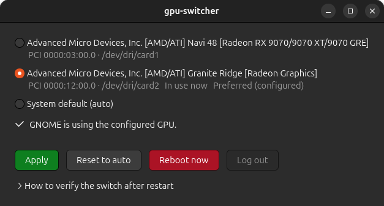

```text
 ██████╗ ██████╗ ██╗   ██╗    ███████╗██╗    ██╗██╗████████╗ ██████╗██╗  ██╗███████╗██████╗
██╔════╝ ██╔══██╗██║   ██║    ██╔════╝██║    ██║██║╚══██╔══╝██╔════╝██║  ██║██╔════╝██╔══██╗
██║  ███╗██████╔╝██║   ██║    ███████╗██║ █╗ ██║██║   ██║   ██║     ███████║█████╗  ██████╔╝
██║   ██║██╔═══╝ ██║   ██║    ╚════██║██║███╗██║██║   ██║   ██║     ██╔══██║██╔══╝  ██╔══██╗
╚██████╔╝██║     ╚██████╔╝    ███████║╚███╔███╔╝██║   ██║   ╚██████╗██║  ██║███████╗██║  ██║
 ╚═════╝ ╚═╝      ╚═════╝     ╚══════╝ ╚══╝╚══╝ ╚═╝   ╚═╝    ╚═════╝╚═╝  ╚═╝╚══════╝╚═╝  ╚═╝
```

[](https://github.com/wl04/gpu-switcher/actions/workflows/ci.yml)
[](https://github.com/wl04/gpu-switcher/releases/latest)
[](LICENSE)

Switch which GPU GNOME (Mutter) uses as the **primary display adapter** - no
hand-edited udev rules, no terminal. Built for multi-GPU machines, e.g. a CPU's
integrated graphics plus one or more discrete GPUs.



## Features

- GPU list with `lspci` names, PCI addresses and `/dev/dri` nodes
- Badges: **In use now** (primary selected by gnome-shell this boot) and
  **Preferred (configured)** (managed udev rule on disk)
- **Apply** / **Reset to auto** under polkit authorization
- **Reboot now** and a **Log out** fast path, enabled after a successful apply
- **State row**: what is running now versus what is configured for the next
  login, whether a log out or a reboot is needed, and, after login, whether
  GNOME actually picked the configured GPU (or ignored the rule)
- Confirmation dialogs, result banners and a manual verification hint
- `gpu-switcher list` and `gpu-switcher status` answer the same questions in a
  terminal, over SSH too
- English and Russian

## Compatibility

Supports **GNOME on Wayland (Mutter) only**; KDE Plasma and X11 are on the
[roadmap](ROADMAP.md).

| Distro | GNOME | GPUs | Status |
|---|---|---|---|
| Ubuntu 26.10 | 51 | AMD RX 9070 + iGPU | Tested by the maintainer |

Other Debian/Ubuntu-based systems with GNOME on Wayland should work; reports
of other combinations are welcome in the
[issue tracker](https://github.com/wl04/gpu-switcher/issues).

## Install

Requires `python3 (>= 3.12)`, `python3-gi`, `gir1.2-gtk-4.0 (>= 4.10)`,
`libgtk-4-1 (>= 4.10)`, `polkitd`, `dbus`, `udev`, `systemd` and `pciutils` -
all standard on Ubuntu/Debian.

Download the latest `.deb` from the
[releases page](https://github.com/wl04/gpu-switcher/releases), then:

```sh
sudo apt install ./gpu-switcher_<version>_all.deb
```

`apt` resolves missing dependencies. To build the package yourself, see
[CONTRIBUTING.md](CONTRIBUTING.md#packaging).

### Upgrading

Restart the still-running helper so the fresh code takes over the D-Bus name:

```sh
sudo systemctl restart gpu-switcher-helper.service
```

### Uninstalling

```sh
sudo apt remove gpu-switcher
```

This leaves the managed udev rule and its backups in place: they are your
primary-GPU choice, not package data. Remove the rule yourself if you no longer
need it (see [Recovery](#recovery)).

## Usage

1. Launch **gpu-switcher** from the GNOME app grid (`man gpu-switcher` is also
   installed).
2. Select a GPU and click **Apply**; authenticate in the polkit prompt.
   **Reset to auto** removes the rule and returns to automatic selection.
3. Click **Log out** (or **Reboot now**) so GNOME picks the new GPU at the next
   session start.
4. After logging back in, the state row confirms that GNOME is using the
   configured GPU. If the app cannot tell (for example the journal is
   unreadable), or GNOME ignored the rule, the window opens the manual check
   instead; you can also run it yourself:

```sh
journalctl -b0 /usr/bin/gnome-shell | grep -E 'selected (as )?primary'
```

### In a terminal

With no command, `gpu-switcher` opens the window. With a command it answers in
the terminal, and it needs no display, so it works over SSH as well:

```sh
gpu-switcher list      # every GPU: card, PCI address, model, what marks it
gpu-switcher status    # the rule on disk, the tag udev applies, what runs now
gpu-switcher version   # the version of the package
```

`list` prints the window's own badges (**In use now**, **Preferred
(configured)**, the outputs that report a monitor), and `status` says what the
rule pins, whether udev applies that tag, which adapter the desktop runs on and
what that adds up to. The commands share the window's detection and decision
logic, so the two cannot disagree about the machine.

## Recovery

If the graphical session fails after a switch, restore automatic selection from
a text console (Ctrl+Alt+F3) or over SSH:

```sh
sudo rm /etc/udev/rules.d/61-mutter-primary-gpu.rules
sudo udevadm control --reload-rules
sudo udevadm trigger --subsystem-match=drm --settle
sudo reboot
```

Backups of replaced rules are kept next to it as
`61-mutter-primary-gpu.rules.bak.*`.

## How it works

Mutter reads the udev tag `mutter-device-preferred-primary` from the card's
current udev tags when the session starts and does not re-read tags
mid-session. `gpu-switcher` writes the managed rule
`/etc/udev/rules.d/61-mutter-primary-gpu.rules` (with backup and conflict
checks) through a root, D-Bus-activated helper under polkit authorization, then
refreshes udev so the new tag is in place. Mutter picks it up at the next login
or reboot. Architecture details are in [DESIGN.md](DESIGN.md).

## Contributing

See [CONTRIBUTING.md](CONTRIBUTING.md) for development setup, checks and the
release process, and [ROADMAP.md](ROADMAP.md) for planned work.

## License

MIT - see [LICENSE](LICENSE).
