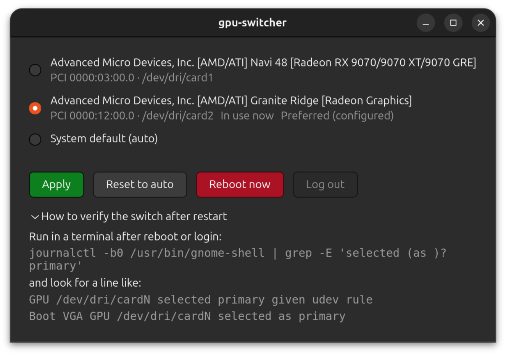

# gpu-switcher

A small GTK 4 GUI application that switches which GPU GNOME (Mutter) uses as
the **primary display adapter** — no hand-edited udev rules, no terminal.

Built for dual-GPU machines (dGPU + iGPU), e.g. a desktop with a discrete AMD
GPU plus the CPU's integrated graphics.

> **v1 scope: GNOME / Wayland (Mutter) only.** KDE Plasma and X11 are planned
> as later extensions.



## Features

- GPU list with `lspci` names, PCI addresses and `/dev/dri` nodes
- Badges: **In use now** (primary selected by gnome-shell this boot) and
  **Preferred (configured)** (managed udev rule on disk)
- **Apply** / **Reset to auto** — write or remove the managed udev rule under
  polkit authorization (a root D-Bus-activated helper does the privileged
  work; the GUI app never touches polkit directly)
- **Reboot now** and the **Log out** fast path (enabled after an apply whose
  udev refresh succeeded — no extra prompt)
- Confirmation dialogs, contextual status banners, a collapsible
  verification hint with the exact `journalctl` command
- English and Russian (gettext; adding a language = one more `.po` file)

## How it works

Mutter reads the udev tag `mutter-device-preferred-primary` from the udev
database when the session starts and does not re-read tags mid-session.
`gpu-switcher` therefore:

1. writes the managed rule `/etc/udev/rules.d/61-mutter-primary-gpu.rules`
   (with backup and conflict checks) under **polkit** authorization;
2. runs the udev refresh (`udevadm` rules reload + a scoped DRM re-trigger)
   under the same authorization, then activates the change via **Reboot**
   (always works) or **Log out** (no extra prompt) — gnome-shell re-reads the
   fresh tag at the next session start.

Verify after restart (the line Mutter writes at session start):

```sh
journalctl -b0 /usr/bin/gnome-shell | grep -E 'selected (as )?primary'
```

## Install

Requires: `python3 (>= 3.12)`, `python3-gi`, `libgtk-4-1`, `polkitd`, `dbus`,
`udev`, `systemd`, `pciutils` — all standard on Ubuntu/Debian.

### `.deb`

Download the latest `.deb` from the
[releases page](https://github.com/wl04/gpu-switcher/releases), then:

```sh
sudo dpkg -i gpu-switcher_*_all.deb
```

After installing, launch the app from the GNOME app grid
(**gpu-switcher**); `man gpu-switcher` is also installed.

When upgrading from an older version, stop a still-running helper first so
the fresh code takes over the D-Bus name:

```sh
sudo pkill -f gpu_switcher_helper
```

### From source

```sh
git clone https://github.com/wl04/gpu-switcher
cd gpu-switcher
./tools/build-deb.sh    # builds ../gpu-switcher_<version>_all.deb (version from debian/control)
sudo dpkg -i ../gpu-switcher_<version>_all.deb
```

Uninstalling (`sudo dpkg -r gpu-switcher`) leaves the managed udev rule and
its backups in place: they are your primary-GPU choice, not package data.
Remove the rule manually if you no longer need it.

## Development

- Plain Python 3 + PyGObject (GTK 4); no compilation.
- `.deb`: `tools/build-deb.sh` (plain `dpkg-deb`); `debian/` supports the
  `dpkg-buildpackage -us -uc` flow — both paths build the same package.
- Release: `tools/release.sh <version> <changelog-bullets>` — bumps
  `debian/control`, prepends the changelog entry, runs the checks, builds
  and lints the `.deb`, commits, and creates the GitHub release.
- gettext catalogs (`po/`) compile with the pure-Python `tools/po2mo.py`.
- Design notes (architecture, polkit, detection, packaging):
  [PLAN.md](PLAN.md).

### Checks

- `make test` — unit tests. Plain stdlib `unittest` (no test-framework
  dependencies); test names follow `Operation_Behavior_Context`.
- `make locale` — compile the gettext catalogs into the source tree.
- `make package` — build the `.deb`.
- End-to-end verification (no CI; on a real GNOME/Wayland machine): run
  the app, apply a switch through the polkit prompt, then confirm after
  restart with
  `journalctl -b0 /usr/bin/gnome-shell | grep -E 'selected (as )?primary'`.

## Roadmap

- KDE Plasma and X11 support
- More languages

## License

MIT — see [LICENSE](LICENSE).
