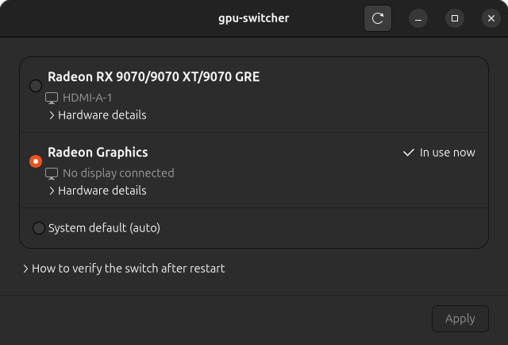

```text
 ██████╗ ██████╗ ██╗   ██╗    ███████╗██╗    ██╗██╗████████╗ ██████╗██╗  ██╗███████╗██████╗
██╔════╝ ██╔══██╗██║   ██║    ██╔════╝██║    ██║██║╚══██╔══╝██╔════╝██║  ██║██╔════╝██╔══██╗
██║  ███╗██████╔╝██║   ██║    ███████╗██║ █╗ ██║██║   ██║   ██║     ███████║█████╗  ██████╔╝
██║   ██║██╔═══╝ ██║   ██║    ╚════██║██║███╗██║██║   ██║   ██║     ██╔══██║██╔══╝  ██╔══██╗
╚██████╔╝██║     ╚██████╔╝    ███████║╚███╔███╔╝██║   ██║   ╚██████╗██║  ██║███████╗██║  ██║
 ╚═════╝ ╚═╝      ╚═════╝     ╚══════╝ ╚══╝╚══╝ ╚═╝   ╚═╝    ╚═════╝╚═╝  ╚═╝╚══════╝╚═╝  ╚═╝
```

[](https://github.com/wl04/gpu-switcher/actions/workflows/ci.yml)
[](https://github.com/wl04/gpu-switcher/releases/latest)
[](LICENSE)

Switch which GPU GNOME (Mutter) uses as the **primary display adapter** - no
hand-edited udev rules. Built for multi-GPU machines, e.g. a CPU's
integrated graphics plus one or more discrete GPUs.



## Features

- GPU preference list with an independent **In use now** indicator and monitor icons
- Expand **Hardware details** under any GPU to inspect its full name, PCI address and `/dev/dri` node without selecting it
- Apply a specific GPU or **System default (auto)** under polkit authorization
- Contextual **Reboot now** or **Log out** action when a session change is needed
- Status messages explain pending changes, an ignored preference, or why the running GPU cannot be verified
- Confirmation dialogs, result banners and a manual verification hint
- `gpu-switcher list` and `gpu-switcher status` answer the same questions in a
  terminal, over SSH too
- English and Russian

## Compatibility

Supports **GNOME on Wayland (Mutter) only**; KDE Plasma and X11 are on the
[roadmap](ROADMAP.md).

| Distro | GNOME | GPUs | Status |
|---|---|---|---|
| Ubuntu 26.10 | 51 | AMD RX 9070 + iGPU | Tested by the maintainer |

Other Debian/Ubuntu-based systems with GNOME on Wayland should work; reports
of other combinations are welcome in the
[issue tracker](https://github.com/wl04/gpu-switcher/issues).

## Install

Requires `python3 (>= 3.12)`, `python3-gi`, `gir1.2-gtk-4.0 (>= 4.10)`,
`libgtk-4-1 (>= 4.10)`, `polkitd`, `dbus`, `udev`, `systemd` and `pciutils` -
all standard on Ubuntu/Debian.

Download the latest `.deb` from the
[releases page](https://github.com/wl04/gpu-switcher/releases), then:

```sh
sudo apt install ./gpu-switcher_<version>_all.deb
```

`apt` resolves missing dependencies. To build the package yourself, see
[CONTRIBUTING.md](CONTRIBUTING.md#packaging).

### Upgrading

Restart the still-running helper so the fresh code takes over the D-Bus name:

```sh
sudo systemctl restart gpu-switcher-helper.service
```

### Uninstalling

```sh
sudo apt remove gpu-switcher
```

This leaves the managed udev rule and its backups in place: they are your
primary-GPU choice, not package data. Remove the rule yourself if you no longer
need it (see [Recovery](#recovery)).

## Usage

1. Launch **gpu-switcher** from the GNOME app grid (`man gpu-switcher` is also
   installed).
2. Select a GPU, or **System default (auto)** to let GNOME choose. The radio is
   the preference you are editing. Until you click **Apply** and authorize the
   change, the saved preference stays the same. **In use now** marks the running
   GPU; the display line on each row describes that card’s monitor connections.
3. Follow the status for the **saved** preference: **Log out** appears when a
   new login is enough; **Reboot now** appears when a reboot is needed. Neither
   button appears when the saved GPU is already in use.
4. After logging back in, **In use now** identifies the running GPU.
   If the app cannot tell (for example the journal is
   unreadable), or GNOME ignored the rule, the window opens the manual check
   instead; you can also run it yourself:

```sh
journalctl -b0 /usr/bin/gnome-shell | grep -E 'selected (as )?primary'
```

### In a terminal

With no command, `gpu-switcher` opens the window. With a command it answers in
the terminal, and it needs no display, so it works over SSH as well:

```sh
gpu-switcher list      # every GPU: card, PCI address, model, what marks it
gpu-switcher status    # the rule on disk, the tag udev applies, what runs now
gpu-switcher version   # the version of the package
```

`list` prints the full device name and labels both **In use now** and **Preferred
(configured)** when applicable. It lists connected outputs and omits display
status if the kernel did not report it. `status` reports the managed rule, the
udev tag, and the running adapter. Neither command changes the preference.

## Recovery

If the graphical session fails after a switch, restore automatic selection from
a text console (Ctrl+Alt+F3) or over SSH:

```sh
sudo rm /etc/udev/rules.d/61-mutter-primary-gpu.rules
sudo udevadm control --reload-rules
sudo udevadm trigger --subsystem-match=drm --settle
sudo reboot
```

Backups of replaced rules are kept next to it as
`61-mutter-primary-gpu.rules.bak.*`.

## How it works

Mutter reads the udev tag `mutter-device-preferred-primary` from the card's
current udev tags when the session starts and does not re-read tags
mid-session. `gpu-switcher` writes the managed rule
`/etc/udev/rules.d/61-mutter-primary-gpu.rules` (with backup and conflict
checks) through a root, D-Bus-activated helper under polkit authorization, then
refreshes udev so the new tag is in place. Mutter picks it up at the next login
or reboot. Architecture details are in [DESIGN.md](DESIGN.md).

## Contributing

See [CONTRIBUTING.md](CONTRIBUTING.md) for development setup, checks and the
release process, and [ROADMAP.md](ROADMAP.md) for planned work.

## License

MIT - see [LICENSE](LICENSE).
